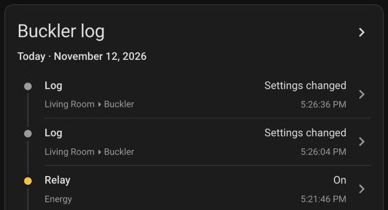
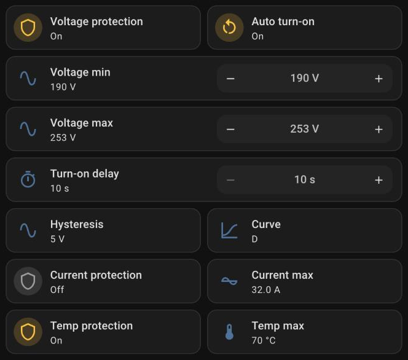
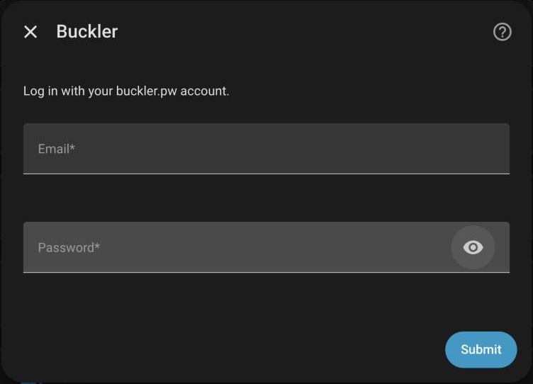

# Home Assistant Buckler integration

The Buckler integration brings [Buckler (Баклер)](https://bakler.com.ua) voltage relays into Home Assistant through their cloud, [buckler.pw](https://buckler.pw): the relay's event log, including why it cut the power, and its protection settings.

Tested with:
* КМР-121-40, the 40 A single-phase Wi-Fi DIN relay

Buckler relays can also publish live readings (voltage, current, power, energy) and the relay itself over MQTT, with their own Home Assistant discovery. This integration doesn't repeat those: use MQTT for live data and this for what MQTT doesn't carry.

## Highlights

### Know why the power went out

Every new entry in the relay's log fires the **Log** event entity, so a trip shows up in the logbook and can trigger an automation within 30 seconds. The event type says what happened (`undervoltage`, `overvoltage`, `overcurrent`, `power_lost`, …), and the event carries the log's code, type, message and time.



### Change protection settings

Everything the Buckler app's protection page has: voltage limits and hysteresis, turn-on delay, current limit and trip curve, power, frequency and device temperature limits, each protection on or off, and auto turn-on. Ranges match the app. A change goes to the relay through the cloud, and Home Assistant waits up to 20 seconds for the relay to confirm it.



### Use the UI to set up integration

Log in with your buckler.pw email and password. Every relay on the account becomes a device. Telegram sign-in isn't supported.



## Example automation

A notification when the relay cuts the power:

```yaml
alias: Buckler cut the power
triggers:
  - trigger: state
    entity_id: event.home_log  # your relay's Log
    not_from: unavailable
conditions:
  - condition: template
    value_template: >
      {{ trigger.to_state.attributes.event_type in
         ['undervoltage', 'overvoltage', 'overcurrent', 'power_limit', 'frequency', 'overheat'] }}
actions:
  - action: notify.notify
    data:
      title: Buckler
      message: "{{ trigger.to_state.attributes.message }}"
```

## Installation

### Via HACS

[](https://my.home-assistant.io/redirect/hacs_repository/?owner=krasnoukhov&repository=homeassistant-buckler&category=Integration)

* Click the button above, or add `https://github.com/krasnoukhov/homeassistant-buckler` to HACS as a custom repository (category: Integration)
* Click on three dots and use the "Download" option
* Follow the steps
* Restart Home Assistant
* Add the integration: Settings → Devices & services → Add integration → **Buckler**

### Manual Installation (not recommended)

* Copy the entire `custom_components/buckler/` directory to your server's `<config>/custom_components` directory
* Restart Home Assistant

## Entities

The ids below leave out the relay's name from the Buckler app: a relay called Home gets `event.home_log`.

### Event

| Entity | Description |
|--------|-------------|
| `event.log` | Fires once for each new log entry. Attributes: `code`, `type` (e.g. `DOWN_VRMS`), `message` (Ukrainian, as in the app), `time`. Entries already there when Home Assistant starts don't fire |

| Event type | Log codes | What happened |
|---|---|---|
| `undervoltage` | 122 | Voltage fell below the minimum |
| `overvoltage` | 120, 121 | Voltage rose above the maximum |
| `overcurrent` | 124, 140, 141, 150–159 | Current above the limit |
| `power_limit`, `frequency`, `overheat`, `residual_current` | 127, 128, 125–126, 123 | Other protections |
| `power_lost`, `power_restored` | 200–202 | The relay itself lost or got back its supply |
| `relay_off`, `relay_on`, `turned_off`, `turned_on`, `button` | 100, 110, 1001–1002, 300–324 | Switching |
| `offline`, `online` | 1021, 1022 | Cloud connection |
| `settings_changed`, `protection_ok`, `schedule` | 129, 130–139, 1011–1012 | Housekeeping |
| `other` | anything else | Firmware and system entries |

### Configuration

Each one is added only if the relay has that setting.

| Entity | Description | Range |
|--------|-------------|-------|
| `number.turn_on_delay` | Wait before turning back on once the fault clears | 10–1800 s |
| `number.voltage_minimum` | Cut below this voltage | 120–210 V |
| `number.voltage_maximum` | Cut above this voltage | 220–280 V |
| `number.voltage_hysteresis` | Hysteresis of the voltage limits | 1–9 V |
| `number.current_maximum` | Current limit | 0.1–60 A |
| `select.current_trip_curve` | Current limit's curve, like on breakers | A, B, C, D |
| `number.power_maximum` | Power limit | 0.02–13.8 kW |
| `number.frequency_minimum`, `number.frequency_maximum` | Frequency limits | 45–49.9, 50.1–65 Hz |
| `number.temperature_maximum` | Relay's own temperature limit | 40–75 °C |
| `switch.voltage_protection`, `switch.current_protection`, `switch.power_protection`, `switch.frequency_protection`, `switch.temperature_protection` | Each protection on or off | |
| `switch.auto_turn_on` | Turn back on by itself after a trip | |

### Diagnostic

| Entity | Description |
|--------|-------------|
| `binary_sensor.cloud_connection` | Whether the relay is connected to buckler.pw |

## Not covered yet

Turning the relay on and off, schedules, energy statistics and tariffs. The relay switch is on MQTT already.

## Development

```sh
uv venv --python 3.14
uv pip install -r requirements_test.txt
.venv/bin/pytest
```
